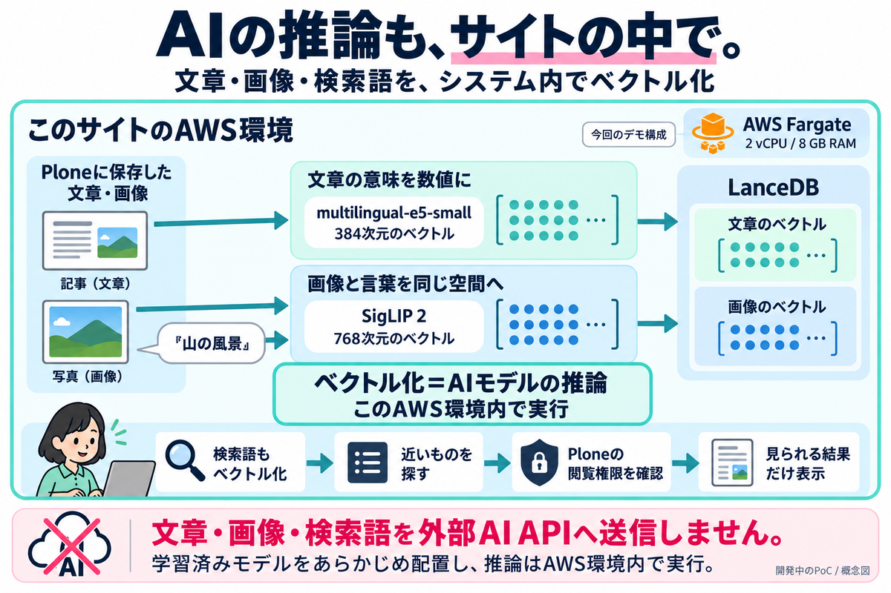

# アップロードした画像が言葉で見つかる：OSC東京でPlone＋LanceDBを実演しました

10月17日（土）の[オープンソースカンファレンス2026 Tokyo/Fall](https://event.ospn.jp/osc2026-fall/)で、PloneとLanceDBを組み合わせた画像検索を実演しました。アップロードした画像がすぐに自然言語で見つかることに驚きがあり、社内でも有効に使えそうだという反応をいただきました。

<!-- more -->

## 画像を登録して、その場で探す

[開催前の記事](2026-10-13-plone-lancedb-search-osc.md)で紹介した開発版を、Plone Users Group Japanのブースで見ていただきました。現在、実証実験を進めているプロダクトです。

デモでは、その場で撮影した写真や、保存してある画像をPloneにアップロードしました。続けて自然言語で検索し、今登録した画像が見つかるところまでを実演しました。

この一連の操作を見て、社内でも有効に使えそうだという声がありました。画像を登録してから探せるようになるまでの流れが、具体的な利用場面を考えるきっかけになりました。

今回は画像検索の実演が中心となり、PDFを使ったデモやタグ付けのデモはほとんどできませんでした。

## 仕組みやOSS公開への質問も

技術者が集まるOSCらしく、画像と言葉をどう結び付けているのか、内部はどのような構成なのか、OSSとして公開されているのかといった質問も多くいただきました。

そこで、会場での説明の途中に構成図を作り、画像の登録から検索結果を表示するまでの流れを説明しました。

画像検索では、SigLIP 2で画像の特徴と検索文の意味をベクトルに変換し、その近さを使ってLanceDBから候補を探します。結果を表示する際は、利用者が閲覧できるコンテンツかをPlone側で確認します。

今回のデモでは、学習済みモデルをサイトのAWS環境に配置し、ベクトル化のための推論もその環境内で実行しています。文章・画像・検索語を外部のAI APIへ送信する構成ではありません。

この組み込みアドオンは、現在実証実験中で、将来的なOSS公開を目指しています。

## 実際に動く検索を見ていただけた

今回の展示では、検索の動きへの驚きから、実装の仕組みや社内での活用まで話が広がりました。ブースに立ち寄り、デモを見て質問してくださった皆さん、ありがとうございました。

PloneとLanceDBの組み込みは、引き続き実証実験を進めています。実装の構成や運用で確認していることも、今後の記事で紹介していきます。
